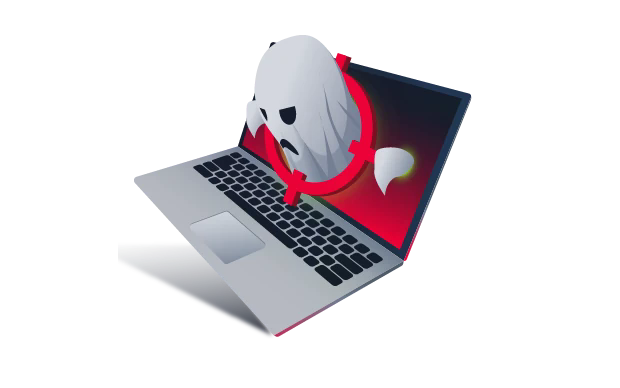

Salut ! Je suis **FChef3**, passionné de **sécurité offensive**. Ce blog me sert à documenter mes projets personnels et ce que j'apprends en pratiquant.

## Ce que vous trouverez ici

- **Writeups** de machines et de CTF
- **Homelab** : mes labs d'entraînement
- **Outils** que je développe sur mon temps libre
- **Recherche** de vulnérabilités (analyse de CVE, divulgation responsable)

## Achivements

### Hack The Box

  
  

### TryHackMe

  
  
  
  

## Mes profils

- Hack The Box : [FChef3 sur HTB](https://app.hackthebox.com/users/1868096)
- TryHackMe : [FChef3 sur TryHackMe](https://tryhackme.com/p/FChef3)
- GitHub : [abasse7](https://github.com/abasse7)
- LinkedIn : [Abasse S.](https://www.linkedin.com/in/abasse-s-b49521243)

<!--
À compléter quand tu veux (non affiché tant que c'est en commentaire) :
## Parcours
- École / stage / alternance
## Certifications et réalisations
- Certifs, ProLabs, classements CTF
-->

> Tous les tests décrits sur ce blog sont réalisés sur mes propres labs, sur des plateformes d'entraînement ou avec une autorisation explicite.
{: .prompt-info }
